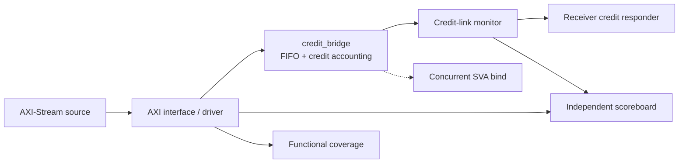

# CreditBridge-DV

CreditBridge-DV is an open-source SystemVerilog/UVM verification project for a
single-clock packet bridge. The DUT accepts AXI4-Stream-style beats, buffers
them in a parameterized FIFO, and transmits them over a deliberately simplified
credit-based link. The protocol is independently specified for verification
training; it is not an implementation or compliance claim for AXI, PCIe, or
CXL.

## Engineering objective

The project exercises the verification responsibilities that matter in a
connectivity device: handshake correctness, packet ordering, FIFO boundaries,
credit conservation, reset flushing, backpressure, assertions, constrained
random stimulus, functional coverage, transaction-level checking, and mutation
testing.

## Architecture



The RTL stores accepted `{TDATA,TKEEP,TLAST}` beats in FIFO memory. The output
side has no ready signal: `m_link_valid` itself denotes a transfer, gated by
FIFO occupancy and available credits. A legal credit return restores one
previously consumed credit; simultaneous send and return conserve the count.
Synchronous reset clears buffered state, pointers, occupancy, and credits.

## DUT and protocol

Default parameters are `DATA_WIDTH=32`, `FIFO_DEPTH=8`, and
`MAX_CREDITS=8`. The input interface is `TVALID/TREADY/TDATA/TKEEP/TLAST`.
The output interface is `m_link_valid/m_link_data/m_link_keep/m_link_last` plus
`m_link_credit_return` and `credits_available`. The complete frozen behavior is
in [`docs/SPEC.md`](docs/SPEC.md).

## Verification methodology

The UVM environment contains an active AXI agent, passive credit-link monitor,
credit-return responder, virtual sequencer, deterministic and randomized
sequences, coverage subscriber, concurrent SVA, and an independent scoreboard.
The scoreboard builds expected beats only from accepted input handshakes and
observed reset events; it never reads DUT FIFO state. End-of-test drain checks
prevent missing output from becoming a vacuous pass.

Coverage is sampled from legal externally observed events. TKEEP bins require
an accepted input handshake, packet length is sampled only at completed packet
boundaries, and credit/occupancy state is derived from interface activity.

## Executed results

The final closeout was run with Verilator 5.052, Accellera UVM 2020.3.2, and
Z3:

| Check | Result |
|---|---:|
| Verilator lint | PASS |
| M1 directed scenarios | 12/12 PASS |
| Parameterized FIFO scenarios | 14/14 PASS total |
| UVM smoke | PASS, seed 101 |
| UVM random regression | 11/11 PASS, seeds 202 and 1–10 |
| User-defined functional coverage | 52/52 bins (100.0%) |
| Directed RTL mutations | 5/5 detected |
| UVM RTL mutations | 5/5 detected |

Evidence is preserved under `results/latest/` when generated locally. The
auditable summaries are [`docs/M2_CLOSEOUT_SUMMARY.md`](docs/M2_CLOSEOUT_SUMMARY.md),
[`docs/COVERAGE_REPORT.md`](docs/COVERAGE_REPORT.md), and
[`docs/MUTATION_INTEGRITY_AUDIT.md`](docs/MUTATION_INTEGRITY_AUDIT.md).

## Reproduce the open-source checks

M1 checks require Verilator 5.032 or newer:

```bash
make lint
make test
make regression
```

The executable UVM flow requires Verilator 5.052, Accellera UVM 2020.3.2, and
Z3. Install these in user-local paths and set `VERILATOR`, `UVM_HOME`, and
`PATH` as described in [`docs/REPRODUCIBILITY.md`](docs/REPRODUCIBILITY.md):

```bash
make uvm-smoke UVM_SEED=101 BUILD_ROOT=/tmp/cb-uvm
make uvm-test UVM_SEED=202 BUILD_ROOT=/tmp/cb-uvm
make uvm-regression UVM_SEEDS="202 1 2 3 4 5 6 7 8 9 10" \
  BUILD_ROOT=/tmp/cb-uvm-regression
make coverage UVM_SEED=1
make uvm-mutation-test BUILD_ROOT=/tmp/cb-uvm-mutants
```

Every runner returns nonzero on compile, simulation, UVM error/fatal, missing
coverage, or missing scoreboard-activity evidence. Seeds are passed both to
UVM and Verilator (`+verilator+seed+N`) for reproducible, distinct stimulus.

## Repository layout

```text
rtl/                 Synthesizable DUT
assertions/          SVA properties and bind wrapper
tb/directed/         Deterministic self-checking harness
tb/uvm/              UVM agents, sequences, scoreboard, coverage, tests
scripts/             Reproducible runners and mutation automation
docs/                Frozen spec, architecture, reports, and interview notes
tests/               Auxiliary smoke and negative-control sources
.github/workflows/   Open-source lint and directed CI
```

## Scope and limitations

Coverage closure is for the tested 32-bit, depth-8, eight-credit configuration;
it is not a claim for every parameter combination. The project uses the
Verilator UVM flow and has not been cross-validated with a commercial simulator.
The reported percentage is user-defined functional coverage, not code coverage.
The design is not PCIe/CXL compliant, and no formal-completeness claim is made.
